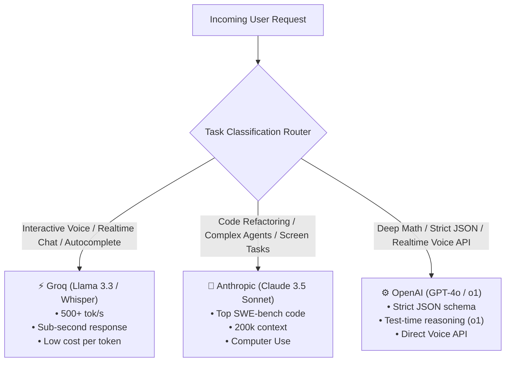

# LLM Comparison: OpenAI vs. Anthropic vs. Groq

A focused, table-first comparison of the three primary pillars in modern AI architecture: **OpenAI** (closed frontier pioneer), **Anthropic** (agentic coding & reasoning leader), and **Groq** (ultra-high-speed LPU inference engine).

---

## 1. At-A-Glance Summary Matrix

| Dimension | OpenAI | Anthropic | Groq |
| :--- | :--- | :--- | :--- |
| **Category** | Proprietary Closed Foundation Lab | Proprietary Closed Foundation Lab | High-Speed Hardware Inference Engine |
| **Flagship Models** | `GPT-4o`, `o1`, `o3-mini`, `GPT-4o mini` | `Claude 3.5 Sonnet`, `Claude 3.5 Haiku`, `Claude 3 Opus` | Hosts `Llama 3.3 70B`, `Llama 3.1 8B`, `Mixtral 8x7B`, `Whisper Large v3` |
| **Primary Superpower** | Strict JSON schema outputs, frontier STEM reasoning (`o1`), Realtime Voice API | Benchmark software engineering (SWE-bench), steerability, GUI "Computer Use" | **Ultra-low latency (300–800+ tok/s)** powered by custom LPU hardware |
| **Key Limitation** | High cost on `o1`, closed models, strict rate limits | No native real-time audio API, closed models | Does not train frontier models; context bound by on-chip SRAM |
| **Hardware / Engine** | Cloud GPUs (NVIDIA H100 / Azure) | Cloud Accelerators (AWS / GCP) | Custom **LPU™ (Language Processing Unit)** |
| **API Compatibility** | Native OpenAI API standard | Anthropic Messages API format | **100% OpenAI API drop-in compatible** |
| **Best For** | General production backends, complex math/logic, voice agents | Autonomous coding agents, complex refactoring, document analysis | Real-time conversational voice, live autocomplete, multi-step agent loops |

---

## 2. Detailed Provider Profiles

### OpenAI
| Aspect | Details |
| :--- | :--- |
| **Role in Stack** | Frontier Reasoning, Production Tooling & Voice |
| **Flagship Models** | • `GPT-4o`: Omnimodal, versatile flagship • `o1` & `o3-mini`: Reinforcement-learning reasoning models for deep logic, math, and STEM • `GPT-4o mini`: Fast, low-cost general-purpose model |
| **Key Strengths** | • **Guaranteed Structured Outputs:** 100% adherence to JSON Schemas (`strict: true`) via constrained grammar decoding • **Realtime API:** Native low-latency bidirectional voice/audio streaming via WebRTC/WebSockets • **Ecosystem Standard:** Massive developer mindshare, Assistants API, and Azure enterprise parity |
| **Limitations** | • Frontier reasoning models (`o1`) carry high per-token pricing and higher latency • Closed weights with no self-hosting option |
| **Deployment Options** | OpenAI API, Microsoft Azure AI Studio |

---

### Anthropic
| Aspect | Details |
| :--- | :--- |
| **Role in Stack** | Software Engineering, Complex Agents & Nuanced Reasoning |
| **Flagship Models** | • `Claude 3.5 Sonnet`: The industry benchmark for code generation and multi-step reasoning • `Claude 3.5 Haiku`: Near-frontier speed and coding at lightweight cost • `Claude 3 Opus`: Deep philosophical synthesis and academic writing |
| **Key Strengths** | • **Best-in-Class Coding:** Outperforms all competitors on software engineering benchmarks (SWE-bench Verified) • **Native "Computer Use":** API feature allowing models to view screens, move mouse cursors, and click UI elements • **Prompt Steerability:** Adheres meticulously to long system instructions with minimal hallucinations and balanced tone • **Visual Document Intelligence:** Exceptional chart, diagram, and PDF document parsing |
| **Limitations** | • No direct real-time speech-to-speech audio API • Closed weights with no self-hosting option |
| **Deployment Options** | Anthropic API, AWS Bedrock, Google Cloud Vertex AI |

---

### Groq
| Aspect | Details |
| :--- | :--- |
| **Role in Stack** | Real-Time Execution, Voice Pipelines & High-Throughput Agent Steps |
| **Hosted Models** | • `Llama 3.3 70B`: Frontier-level open weights at blazing speeds • `Llama 3.1 8B`: Instantaneous edge/utility model (>800 tokens/sec) • `Whisper Large v3`: Sub-second speech-to-text audio transcription |
| **Key Strengths** | • **Unrivaled Speed:** Delivers **300 to 800+ tokens/sec**, roughly 5x to 10x faster than traditional GPU cloud inference • **Instant Time-to-First-Token (TTFT):** Typically under 150 ms, eliminating conversational lag • **OpenAI SDK Drop-in:** Works immediately with standard OpenAI libraries by changing `base_url` • **Cost Efficiency:** Very low inference cost per million tokens for open-weight models |
| **Limitations** | • **Cannot run proprietary frontier models:** Hosts open-weight models only (cannot run GPT-4o or Claude 3.5) • **Context Constraints:** On-chip SRAM architecture limits very long context windows (typically 8k–128k depending on model) |
| **Deployment Options** | GroqCloud API |

---

## 3. Head-to-Head Technical Comparison Tables

### Table A: Speed, Latency & Throughput

| Metric | Groq (LPU) | OpenAI | Anthropic |
| :--- | :--- | :--- | :--- |
| **Throughput (Tokens/sec)** | **300 – 800+ tok/s** (Fastest) | 60 – 110 tok/s | 70 – 120 tok/s |
| **Time to First Token (TTFT)** | **< 150 ms** | ~ 400 – 600 ms | ~ 400 – 500 ms |
| **Execution Architecture** | Custom LPU (SRAM, no HBM bottlenecks) | NVIDIA H100 / GPU Clusters | Custom Cloud Accelerators (AWS/GCP) |
| **Fastest Model** | `Llama 3.1 8B` (800+ tok/s) | `GPT-4o mini` (~110 tok/s) | `Claude 3.5 Haiku` (~120 tok/s) |
| **Conversational Voice Latency** | Instantaneous (<0.5s total turn) | Near-instant via Realtime API | Requires external STT/TTS pipeline |

---

### Table B: Coding, Reasoning & Agentic Workflows

| Capability | Anthropic | OpenAI | Groq |
| :--- | :--- | :--- | :--- |
| **Software Engineering (SWE-bench)** | **Best in Class (`Claude 3.5 Sonnet`)** | Strong (`GPT-4o`, `o1`) | Model-dependent (`Llama 3.3 70B` is very good) |
| **Deep STEM / Math Reasoning** | High (Logical reasoning) | **Best in Class (`o1` & `o3-mini`)** | Standard feed-forward reasoning |
| **Structured Output Guarantee** | Tool calling with JSON validation | **Deterministic JSON Schema (`strict: true`)** | Standard JSON Mode (model-dependent) |
| **GUI / Computer Navigation** | **Native API ("Computer Use")** | In development / Preview | Not supported |
| **Multi-Step Agent Loops** | High intelligence, moderate loop speed | High intelligence, moderate loop speed | **Fastest loop execution** (ideal for 10+ sub-agent calls) |

---

### Table C: Context Window & Multimodal Capabilities

| Feature | Anthropic | OpenAI | Groq |
| :--- | :--- | :--- | :--- |
| **Max Context Window** | **200,000 tokens** | 128,000 tokens | 8,000 – 128,000 tokens (model-dependent) |
| **Vision (Images / PDFs)** | **Industry-leading chart & diagram parsing** | Strong (GPT-4o Vision) | Supported on select vision models |
| **Native Audio Input/Output** | No (Text/Vision only) | **Yes (GPT-4o Realtime Voice API)** | Integrated via Whisper LPU (Speech-to-Text) |
| **Video Understanding** | Frame sampling | Frame sampling | Limited / Not primary focus |
| **Needle-in-a-Haystack Recall** | > 99% across 200k tokens | > 98% across 128k tokens | High within supported context bounds |

---

### Table D: Developer Experience & Tooling

| Feature | OpenAI | Anthropic | Groq |
| :--- | :--- | :--- | :--- |
| **API Protocol** | OpenAI REST / SDK | Anthropic Messages REST / SDK | **OpenAI REST / SDK compatible** |
| **Function / Tool Calling** | First-class, strict schema support | First-class, XML tag-based or JSON tools | First-class OpenAI-compatible tools |
| **SDK Availability** | Python, TypeScript, community | Python, TypeScript | Uses OpenAI Python / TS SDKs |
| **Fine-Tuning Support** | Yes (GPT-4o, GPT-4o mini) | Custom enterprise programs | No (Inference only) |
| **Cloud Availability** | OpenAI, Microsoft Azure | Anthropic, AWS Bedrock, GCP Vertex | GroqCloud |

---

## 4. Scenario Decision Guide: Which One Should You Pick?

| If your project requirement is... | Winner | Runner-Up | Why? |
| :--- | :--- | :--- | :--- |
| **Real-time conversational voice bot** | **Groq** | OpenAI (Realtime API) | Groq delivers speech-to-speech loops in under 500ms using Whisper + Llama 3.3. |
| **Building a coding agent or IDE plugin** | **Anthropic (Claude 3.5 Sonnet)** | OpenAI (`o1` / `o3-mini`) | Claude 3.5 Sonnet produces the most reliable, bug-free multi-file code refactors. |
| **Strict JSON backend data extraction** | **OpenAI (GPT-4o)** | Anthropic (Claude 3.5) | OpenAI's constrained grammar engine guarantees valid JSON output matching your exact schema. |
| **Competitive math, logic & Olympiad problems** | **OpenAI (`o1`)** | Anthropic (Claude 3.5 Sonnet) | `o1` spends test-time compute to think and self-correct through complex algorithmic logic. |
| **High-throughput sub-agent chains (10+ steps)** | **Groq** | Anthropic (Claude 3.5 Haiku) | Sequential agent chains compound latency; Groq runs 10 steps in the time GPU clouds run 2. |
| **GUI desktop automation (clicking & typing)** | **Anthropic** | None | Anthropic provides the only native "Computer Use" API capable of interpreting screen coordinates. |
| **Analyzing large documents (100k–200k tokens)** | **Anthropic** | OpenAI | Anthropic's 200k context maintains exceptional recall and coherence across lengthy PDFs. |
| **Minimal latency autocomplete / inline search** | **Groq** | OpenAI (GPT-4o mini) | Over 800 tokens/sec on Llama 3.1 8B makes generation feel instantaneous to the user. |

---

## 5. The Production Triad Architecture

In modern production systems, these three providers are rarely treated as rivals—they form the **ideal complementary stack**:

